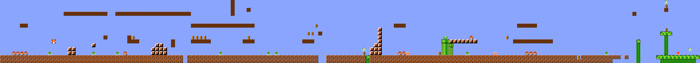
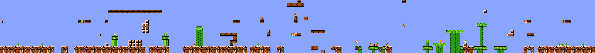
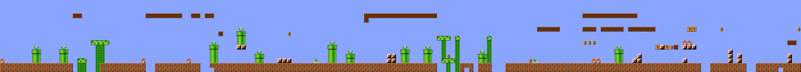
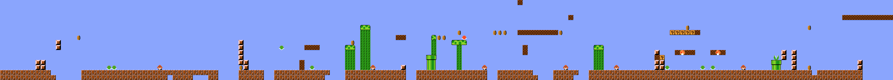
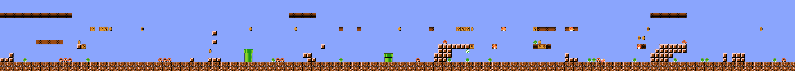
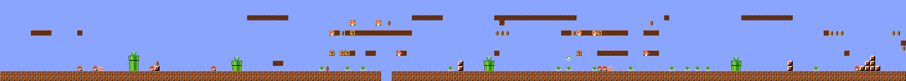
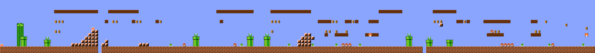
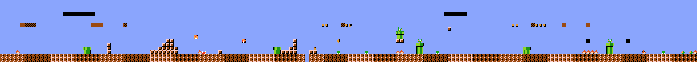
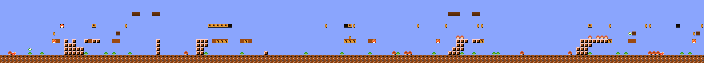
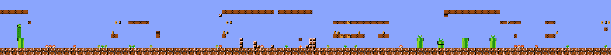

# Mario-Fun-Study: dataset, player paths, and fun comparisons

This report audits the supplied [Mario-Fun-Study](Mario-Fun-Study/) checkout against [Fun as Moderate Divergence: Evaluating Experience-Driven PCG via RL](Fun_as_Moderate_Divergence_Evaluating_Experience-Driven_PCG_via_RL.pdf). Repository commit: `c0171e7ced2838f893013198eb4b1b86db23c236`. Counts below describe these local files, not an assumed newer release. Paper page numbers are **PDF pages, starting at 1**; the printed journal pages run from 360 to 373.

**The dataset supports your proposed representation:** a static character grid, a separate human path mask on the same grid, and a tile-one-hot-plus-path tensor. Its supervision consists of **comparative human fun judgments**, rather than an absolute fun score assigned to every level. The correct training item is normally **a particular participant's playthrough of a particular level**.

The reproducible export is now implemented in [preprocess_dataset.py](preprocess_dataset.py), with reproduction steps in [PREPROCESSING.md](PREPROCESSING.md) and generated pairs in [preprocessed_dataset/](preprocessed_dataset/). The final export uses **21 literal tile channels, omitting `b/B`, plus one path channel**. It retains 90 decisive Experiment I comparisons and expands 91 three-level rankings into 273 pairs, for **363 instance folders**. The 17 equally-fun and 17 neither-fun judgments are omitted from this export. The export removes the first 16 columns from every 192-column source map and crops the participant path by the same amount, producing `(22, 16, 176)` tensors. Its default split has 232 training, 58 validation, and 73 test comparisons. The larger source-audit counts below still describe the complete cleaned release, before that final selection; source dimensions and source-coordinate path statistics remain 16×192 unless stated otherwise.

## 1. Main findings for your project

- The main formal-study pool contains **930 different maps**, all **16 rows × 192 columns**. A `.lvl` file is already a plain-text character grid, and the current export retains columns `16:192` in its tile `.txt` files.
- The supplied cleaned annotations cover **313 distinct maps** and **518 distinct participant–level playthroughs**. The remaining maps do not automatically have usable cleaned human fun supervision.
- Player positions are ordered pixel coordinates. To match the repository's drawn path marker, use `column = floor(x / 16)` and `row = floor((y - 8) / 16)`, with the origin at the upper-left.
- Preserve the static tile and path in separate channels. A cell has one active tile channel, plus a second active bit if the path visits it. Even an empty cell has an active empty-tile channel.
- Experiment I provides A/B/equally-fun/neither-fun judgments; Experiment II provides three-level rankings. Join both to the **same participant's** paths. Neither experiment supplies a global numerical ranking of all levels.
- Important release issues include a stricter effective cleaning threshold than the paper, **630 versus 633** representative levels, one repeated ranking submission, and out-of-grid path points. These are detailed in Sections 10–11.

## 2. What the experiments collected

The paper studies whether moderate changes in level structure and gameplay are associated with fun. Its generated levels are Mario AI Framework levels, not images of levels.

| Experiment | Level source | Human annotation | Main local map pool |
|---|---|---|---|
| I | Playable GAN-generated levels selected to cover the level/gameplay metric space | Compare two played levels: A, B, equally fun, or neither fun | `lvl0.lvl` through `lvl629.lvl`: 630 maps |
| II | RL level generators trained using Runner, Killer, and Collector agent personas | Rank three played levels from most to least fun | `Runner-0`–`Runner-99`, `Killer-0`–`Killer-99`, `Collector-0`–`Collector-99`: 300 maps |

The paper describes 50,000 playable candidates and 633 representatives for Experiment I, and 100 levels per generator for Experiment II (PDF p. 6, Section V-A and Figure 4). The underlying GAN was trained on overlapping 16×16 windows, at stride one, from 15 human-authored source levels. Those source maps are in [`smb/levels/`](Mario-Fun-Study/smb/levels/).

**A generator's persona is different from the human's behavior or fun preference.** For example, `Runner-16` names a map produced by the Runner-based generator. A trace named `<participant>_Runner-16.json` is that human participant's playthrough of it. The filename does not mean the recorded path was produced by the Runner agent.

Participants could submit multiple rounds. Therefore annotation rows, participants, maps, and playthroughs are different counting units.

### 2.1 Experiment I: two sample pair rankings

These are the first two pair judgments in the cleaned [annotation.csv](Mario-Fun-Study/exp_data/survey_data/formal/annotation.csv). Each pair is displayed in the participant's **most-to-least fun order**; `>` means preferred in that comparison, not a global score.

The images below are the dataset's released PNGs, showing static level layouts without player-path overlays. All ten example PNGs are **2816×256 pixels**, or **176×16 tiles**, whereas the corresponding stored grids are **192×16 tiles**. Their narrower width is consistent with excluding the 16-column starting segment discussed in Section 5.4. Project paths in the complete `.lvl` coordinate system, then crop tiles and paths together for the current export. Click an image to open its full resolution.

**Pair 1: `lvl89 > lvl134`.** Source: first data row, `ANNT=A`, participant `f1db3f62-7202-4d4f-ab26-8f7b7cb62c2a`.

More fun: **`lvl89`**.

[](Mario-Fun-Study/exp_data/survey_data/formal/levels/lvl89.png)

Less fun: **`lvl134`**.

[](Mario-Fun-Study/exp_data/survey_data/formal/levels/lvl134.png)

**Pair 2: `lvl91 > lvl33`.** Source: second data row, `ANNT=A`, participant `0cbaa3ae-5376-4d7f-8053-7daba92be456`.

More fun: **`lvl91`**.

[](Mario-Fun-Study/exp_data/survey_data/formal/levels/lvl91.png)

Less fun: **`lvl33`**.

[](Mario-Fun-Study/exp_data/survey_data/formal/levels/lvl33.png)

### 2.2 Experiment II: two sample triple rankings

These are the first two three-level rankings in the cleaned [annotation2.csv](Mario-Fun-Study/exp_data/survey_data/formal/annotation2.csv). Each triple is displayed from **rank 1 (most fun) to rank 3 (least fun)**. The lowercase ranking codes are resolved through the concrete `R`, `K`, and `C` map columns, as described in Section 9.3.

**Triple 1: `Runner-16 > Killer-29 > Collector-42`.** Source: first data row, codes `r,k,c`, participant `0cbaa3ae-5376-4d7f-8053-7daba92be456`.

Rank 1: **`Runner-16`**.

[](Mario-Fun-Study/exp_data/survey_data/formal/levels/Runner-16.png)

Rank 2: **`Killer-29`**.

[](Mario-Fun-Study/exp_data/survey_data/formal/levels/Killer-29.png)

Rank 3: **`Collector-42`**.

[](Mario-Fun-Study/exp_data/survey_data/formal/levels/Collector-42.png)

**Triple 2: `Collector-85 > Runner-5 > Killer-76`.** Source: second data row, codes `c,r,k`, participant `7699c3d2-fb67-40f4-a8c2-d04c9c59d7f1`.

Rank 1: **`Collector-85`**.

[](Mario-Fun-Study/exp_data/survey_data/formal/levels/Collector-85.png)

Rank 2: **`Runner-5`**.

[](Mario-Fun-Study/exp_data/survey_data/formal/levels/Runner-5.png)

Rank 3: **`Killer-76`**.

[](Mario-Fun-Study/exp_data/survey_data/formal/levels/Killer-76.png)

## 3. Files to use, and files to keep separate

Let `formal/` mean [`Mario-Fun-Study/exp_data/survey_data/formal/`](Mario-Fun-Study/exp_data/survey_data/formal/).

| Location | Contents and observed size | Role |
|---|---|---|
| `formal/levels/*.lvl` | 941 top-level maps: 930 study maps plus 11 auxiliary maps | Static tile grids; select the study naming patterns explicitly |
| `formal/levels/*.png` | 932 images | Visualizations, not the authoritative typed grids |
| `formal/levels/original/` | Five additional variable-width maps | Separate source/reference maps, not alternate versions of generated `lvl*` maps |
| `formal/jsons/*.json` | 744 raw gameplay logs | Positions, actions, state, and recorded ticks |
| `formal/reps/*.rep` | 744 binary replay files | Action replays; unnecessary for extracting positions already present in JSON |
| `formal/res/*.json` | 739 processed gameplay records | Convenient human trace and outcome source |
| `formal/res-reproduce/*.json` | 739 records, byte-identical to the corresponding `res/` files | Duplicate results, not additional observations |
| `formal/annotation.csv` | 124 cleaned pair judgments | Experiment I supervision |
| `formal/annotation2.csv` | 91 cleaned three-level rankings | Experiment II supervision |
| `formal/questionare.csv` | 90 rows and 90 participant IDs | Cleaned questionnaire; retain this exact misspelling in paths |
| `formal/data/annotation.csv` | 187 raw pair judgments | Reconstruct filtering or choose another documented policy |
| `formal/data/annotation2.csv` | 104 raw rankings | Same purpose for Experiment II |
| `formal/data/questionare.csv` | 240 rows but 193 distinct IDs | Raw questionnaire includes repeat rows |
| `formal/metric_vals.csv` | 337 calculated metric records | Derived proxies, not human fun labels |
| `formal/metric_vals-partial.csv` | 371 calculated records | Intermediate proxy table |
| `formal/vary-goal-div/` | 52 CSVs | Metric parameter analyses, not additional human annotations |

The 11 auxiliary top-level maps are `t1.lvl`–`t10.lvl` and `tt1.lvl`. They have 16 rows but widths from 149 to 222, and some use extra aliases or tile classes absent from the study maps. Do not include them just because they end in `.lvl`.

[`analysis/survey1/`](Mario-Fun-Study/analysis/survey1/) is a **separate pilot**, with five questionnaire participants, 10 pair judgments, 202 maps, and 21 replay/text records. Its annotation schema includes `IP,A-ID,B-ID,Anno`. Its `lvl*` identifiers do not share the formal experiment's namespace. Other random-generation and simulation folders likewise should not acquire human labels by filename coincidence.

## 4. Audited sample counts

| Counting unit | Raw annotations | Supplied cleaned annotations | Paper's reported final sample |
|---|---:|---:|---:|
| Participants with at least one annotation | 98 | 90 | 93 |
| Experiment I pair judgments | 187 | 124 | 145 |
| Experiment II ranking judgments | 104 | 91 | 97 |

The paper initially reports 193 people filling in questionnaires (PDF p. 7). This agrees with the raw questionnaire's **distinct ID count**, despite that file containing 240 rows.

For the supplied cleaned files:

| Measure | Count |
|---|---:|
| Participants in Experiment I | 83 |
| Participants in Experiment II | 72 |
| Participants in both | 65 |
| Experiment I item appearances / distinct playthroughs | 248 / 248 |
| Experiment II item appearances / distinct playthroughs | 273 / 270 |
| Combined item appearances / distinct playthroughs | 521 / 518 |
| Distinct Experiment I maps | 138 |
| Distinct Experiment II maps | 175 |
| Combined distinct maps | 313 |

Here an **item appearance** is one side of a comparison or one position in a ranking. A **distinct playthrough** is a unique `(participant ID, level ID)` file key. The difference between 521 and 518 comes from a repeated ranking that reuses the same three paths.

Every cleaned item has a matching level, processed result, and raw gameplay JSON. All 930 main study maps, including the 313 used by cleaned annotations, are different by complete grid content.

The broader processed collection contains 739 playthroughs from 118 participant IDs over 372 maps. It is larger than the cleaned labeled subset, but it is still not a human path collection for all 930 maps.

**Cleaned does not mean the player won.** Among the 518 distinct cleaned playthroughs, statuses are 360 `WIN`, 145 `LOSE`, and 13 `TIME_OUT`. Removing failures would produce a different dataset and could remove meaningful fun judgments about difficult levels.

## 5. Tile types and the character grids

### 5.1 Geometry and orientation

Read a `.lvl` file as lines from top to bottom, and characters from left to right:

```text
grid[row][column]
row = 0..15, increasing downward
column = 0..191, increasing to the right
one tile = 16 × 16 pixels
stored map = 3072 × 256 pixels
```

Newlines separate rows and are not tiles. Preserve case and symbols: `k` and `K`, for example, are different enemy types. A tile file does not need commas, spaces, or an added Mario character.

### 5.2 Complete vocabulary

The authoritative codebook is [`src/smb/level.py`](Mario-Fun-Study/src/smb/level.py), lines 17–55. It defines 21 canonical model classes, plus accepted aliases. The table gives their meanings and literal occurrence counts across **all 930 main maps**, totaling **2,856,960 cells**.

The final two channel IDs below are a **proposed lossless extension**, not the repository's canonical IDs.

| Tile channel ID | Character | Meaning | Literal cells in 930 maps |
|---:|:---:|---|---:|
| 0 | `X` | Solid tile, used for ground in reconstructed maps | 305,467 |
| 1 | `S` | Breakable block | 65,492 |
| 2 | `-` | Empty tile | 2,251,804 |
| 3 | `%` | Mushroom platform | 38,387 |
| 4 | `t` | Normal tube/pipe | 3,462 |
| 5 | `T` | Flower tube/pipe | 20,258 |
| 6 | `b` | Bullet Bill body | 0 |
| 7 | `B` | Bullet Bill head | 0 |
| 8 | `o` | Coin | 19,155 |
| 9 | `Q` | Coin question block | 3,849 |
| 10 | `@` | Mushroom question block | 777 |
| 11 | `U` | Mushroom breakable block | 866 |
| 12 | `L` | 1UP block | 7 |
| 13 | `1` | Invisible 1UP block | 1 |
| 14 | `2` | Invisible coin block | 320 |
| 15 | `g` | Goomba | 7,219 |
| 16 | `k` | Green Koopa | 7,060 |
| 17 | `r` | Red Koopa | 1,291 |
| 18 | `K` | Flying green Koopa | 1,053 |
| 19 | `R` | Flying red Koopa | 13 |
| 20 | `y` | Spiky | 501 |
| 21, proposed | `#` | Solid alias, mapped to `X` by the canonical encoder | 47,783 |
| 22, proposed | `\|` | Mushroom stalk, mapped to empty by the canonical encoder | 82,195 |

There are **21 literal characters actually present** in the main pool: canonical `b` and `B` are absent, while `#` and `|` are present. Only 19 of these literal characters appear in the 313 cleaned-labeled maps; `1` and `L` are also absent there. Thus very rare classes in the complete pool may have little or no human preference supervision.

The repository's canonical encoder deliberately merges some characters:

```text
# -> X       | -> -       C -> o       ! -> Q
? -> @       E -> g       F -> -       M -> -
```

`|` is a stalk decoration beneath mushroom platforms. The renderer canonicalizes the map and regenerates stalks from platforms; see `MarioLevel.from_num_arr()` and `LevelRender.render()` in the same source file. Preserving `|` in the original text is useful even if you later choose to merge it with empty space for modeling.

### 5.3 Which tile types occur in a particular level?

Inspect the characters in that level, rather than assuming every class occurs in every file. Examples from the cleaned data:

| Level | Distinct literal characters, sorted by character code |
|---|---|
| `lvl89` | `# % - K S T U X g k o r t y` and `\|` |
| `lvl134` | `# % - @ K S T U X g k o` and `\|` |
| `Runner-16` | `# % - @ K Q S U X g k o t y` and `\|` |

This read-only example inventories **each** main-study level, including its dimensions and per-character counts. Run from the project directory; it does not export files.

```python
from pathlib import Path
from collections import Counter
import re

BASE = Path("Mario-Fun-Study/exp_data/survey_data/formal")
STUDY_NAME = re.compile(r"(?:lvl\d+|(?:Runner|Killer|Collector)-\d+)")

level_inventory = {}
for file in sorted((BASE / "levels").glob("*.lvl")):
    if not STUDY_NAME.fullmatch(file.stem):
        continue
    rows = file.read_text().splitlines()
    assert len(rows) == 16 and all(len(row) == 192 for row in rows)
    level_inventory[file.stem] = {
        "height": len(rows),
        "width": len(rows[0]),
        "tile_counts": dict(sorted(Counter("".join(rows)).items())),
    }
assert len(level_inventory) == 930
# Inspect any entry, or print all entries when needed:
# print(level_inventory["lvl89"])
```

### 5.4 Eleven generated segments versus twelve stored segments

The paper describes **11 generated 16×16 segments** (PDF p. 6), whereas the saved study grids have 192 columns, or **12 segments**. Evidence strongly supports an additional starting buffer:

- [`lvls/buffer_seg.lvl`](Mario-Fun-Study/lvls/buffer_seg.lvl) is 16×16.
- The first 16 columns match it exactly in all 300 persona maps and 563 of the 630 `lvl*` maps.
- The other 67 `lvl*` prefixes differ only around mushroom platform/stalk boundary cells at columns 14–15. There are six prefix variants altogether.
- Generation calls request `l=11` in [`analysis/algo/analyse_designer.py`](Mario-Fun-Study/analysis/algo/analyse_designer.py), lines 182–184. Reward computation begins at segment index 1 in [`src/env/rfunc.py`](Mario-Fun-Study/src/env/rfunc.py), line 113.

The exact historical concatenation operation was not found, so the buffer explanation is a supported interpretation rather than proof of every file's construction history.

**The current export removes the first 16 columns from every level.** Raw player x coordinates align with the 192-column source maps. Cropping tiles and the path mask to columns `16:192` produces 176 columns; equivalently, use `column = floor(x / 16) - 16` or `x_new = x - 256` for the exported coordinates. Prefix positions fall outside the cropped map and are omitted from occupancy. Source files, preference labels, and split grouping remain unchanged. The source-prefix variants described above are all removed by the same fixed crop.

## 6. What the player path files contain

### 6.1 Processed records

Use:

```text
formal/res/<participant_id>_<level_id>.json
```

All 739 processed files have these fields:

```text
status
completing-ratio
#kills
#kills-by-fire
#kills-by-stomp
#kills-by-shell
trace
lives
```

`trace` is an **ordered list of `[x, y]` pixel coordinates**, not tile indices and not a raster mask. Repeated coordinates are retained. Completion is a progress measure; it is not a fun label, and a high value does not imply `WIN`.

The source extraction routine computes progress as `last_x / ((16 * 12 - 1) * 16)`, i.e. `last_x / 3056`; see [`analysis/survey/preprocess.py`](Mario-Fun-Study/analysis/survey/preprocess.py), lines 25–35. The shipped rich result records also contain replay-derived outcomes, whereas this particular preprocessing function writes only `trace` and `completing-ratio`.

### 6.2 Raw gameplay records

The corresponding raw file is:

```text
formal/jsons/<participant_id>_<level_id>.json
```

It contains `modCount0`, `elementData1`, and `size2`. In `elementData1`, element 0 is a Java array type string, not a gameplay event. Start from element 1 and stop at the first `null`. Event fields include:

| Raw field | Use |
|---|---|
| `marioX1`, `marioY2` | World pixel position |
| `actions0` | Encoded action information |
| `marioState3` | Recorded Mario state |
| `marioOnGround4` | Recorded ground-state information |
| `time5` | Recorded tick value; preserve if timing is needed |

For **every one of the 739 processed files**, the entire `trace` exactly matches the positions extracted this way from its raw counterpart. This was checked across all 1,248,650 processed position samples. No replay simulator is needed to obtain those positions.

Do not infer seconds by assuming a frame rate. The processed trace has no time field, and the raw recorded ticks are the appropriate source for a timing analysis.

### 6.3 Human paths versus agent paths

The human survey records above are appropriate for joining to the human comparisons. Other repository JSONs, such as source-level `*_simlt_res.json` files, can contain **agent** simulation data with a different schema. Agent-generated segment traces may use segment-local x coordinates; [`src/smb/proxy.py`](Mario-Fun-Study/src/smb/proxy.py), `get_seg_infos()`, explicitly subtracts a segment's first x position. Do not treat such arrays as whole-level human coordinates.

The survey metric scripts refer to agent traces under `exp_data/agent_simlt_res/`, but that directory is absent from this checkout. The supplied human `res/` files are sufficient for your proposed human map/path representation.

## 7. Aligning the player path to the tile grid

### 7.1 Coordinate rule

The repository uses 16-pixel tiles and draws trace points at `(x, y - 8)`; see [`src/smb/level.py`](Mario-Fun-Study/src/smb/level.py), `LevelRender.tex_size` and lines 346–350. To make your mask agree with that marker convention:

```text
column = floor(x / 16)
row    = floor((y - 8) / 16)
```

These are source-grid coordinates; the current exported coordinate is `column - 16` with valid columns 0–175. The source-coordinate examples and statistics in this section retain the complete 192-column frame. This identifies one marker cell per sample. It is not a reconstruction of Mario's full body footprint, and the rendering code alone does not establish that the marker is his exact physical center.

For participant `f1db3f62-7202-4d4f-ab26-8f7b7cb62c2a` playing `lvl89`:

| Sample index, zero-based | Pixel position | Grid `(row, column)` | Original tile |
|---:|---|---|:---:|
| 0 | `[8, 223]` | `(13, 0)` | `-` |
| 140 | `[153.9441680908203, 175.5]` | `(10, 9)` | `%` |
| 2557 | `[3056, 223]` | `(13, 191)` | `-` |

For example, the first point gives `floor(8/16)=0` and `floor((223-8)/16)=13`. Keep floor behavior for negative values; truncating a small negative number toward zero would incorrectly place it inside the grid.

### 7.2 Out-of-grid samples and repeated visits

| Trace population | Ordered samples | Consecutive duplicate transitions | Out-of-grid samples | Traces with an out-of-grid sample |
|---|---:|---:|---:|---:|
| All 739 processed playthroughs | 1,248,650 | 431,573 | 3,478 | 362 |
| 518 distinct cleaned-labeled playthroughs | 890,752 | 276,072 | 2,451 | 266 |

For all processed traces, 1,107 points project above the grid and 2,371 below it. None project outside it horizontally. For the cleaned subset, the split is 808 above and 1,643 below. These counts use the marker conversion above, not an unshifted `y/16` conversion.

**Skip invalid points when setting an in-grid mask, but preserve them in the ordered trajectory with a validity flag.** Clamping them to row 0 or row 15 would invent path visits along the grid boundary. A path-only mask cannot describe movement outside the stored level.

Do not remove repeated samples from the primary ordered trajectory. They can represent stopping or time spent in a position. A binary mask can collapse them naturally, but loses their frequency.

Use sampled occupancy as the initial mask: mark the cell containing each valid recorded point. Connecting points with lines and filling intermediate cells is a separate derivation. Movement discontinuities, including apparent resets, occur, so interpolating every consecutive pair can invent a path across unvisited space.

### 7.3 Why overlap with nonempty tiles is expected

The `.lvl` grid describes the **initial** level. During play, enemies move, coins disappear, blocks can change, and the marker may cross platform cells. Consequently, overlap with an initial coin, enemy, or block does not by itself establish an alignment error.

In the `lvl89` example, the path visits 403 distinct valid cells: 355 initially empty cells, 15 stalk cells, 11 coins, 11 Goombas, seven green Koopas, two platform cells, one Spiky, and one flying green Koopa. Preserve the original tile channel at every visited cell. These initial tile types are not a record of the object's state at the moment of passage.

The paper explicitly notes that position-only traces omit gameplay events and that agent personas do not precisely reproduce human behavior (PDF p. 12, Sections VII-B/C).

## 8. Exported text files and multi-hot encoding

### 8.1 Instance files and the original ordered positions

The implemented export places each preferred/less-preferred pair in its own folder:

```text
preprocessed_dataset/<train_set|validation_set|test_set>/<instance_id>/
    <preferred_level>.tiles.txt
    <preferred_level>.path.txt
    <preferred_level>.npy
    <less_preferred_level>.tiles.txt
    <less_preferred_level>.path.txt
    <less_preferred_level>.npy
    ranking.txt
```

1. **Tile text:** 16×176 characters, one row per line, retaining source columns `16:192` in each relevant instance folder.
2. **Path-mask text:** an aligned 16×176 grid, using `x` for unvisited and `P` for visited. It contains no tile characters. `P` is an export symbol, not a tile in the source maps.
3. **Merged tensor:** a `(22, 16, 176)` NumPy `uint8` array per playthrough, preserving tile identity and independent path occupancy.
4. **Ranking text:** two level IDs, one per line, preferred first.

A mask preserves *where* the player went. The ordered positions preserve *how* the player moved. The original ordered positions remain in the source `res/` files, linked by the export's manifest; no separate ordered-position file is included among the seven requested instance files. Retain those source logs for later analyses of order, backtracking, stopping, and off-grid motion.

### 8.2 Choose and save an explicit channel codebook

There are three reasonable choices. Their shapes alone do not identify their semantics.

| Codebook | Tile channels | Total with one path channel | Consequence |
|---|---:|---:|---|
| Preserve the 21 literal characters observed in the 930 study maps | 21 | 22 | Lossless for these study maps; omits unobserved `b/B` |
| Use the repository's canonical 21 classes | 21 | 22 | Merge `#→X` and `\|→-`; two canonical classes are unused in the study maps |
| Keep canonical 21 classes and add literal `#` and `\|` | 23 | 24 | Preserves the study grids and reserves channels for `b/B` |

The implemented export and the example below use the **first option: 21 literal tile channels plus one path channel**, omitting `b/B`. The ordered vocabulary is `X,S,-,%,t,T,o,Q,@,U,L,1,2,g,k,r,K,R,y,#,|,PATH`, with path at index **21**. These indices differ from the repository's canonical IDs in Section 5. The exact final codebook is saved in [preprocessed_dataset/channels.json](preprocessed_dataset/channels.json) and documented in [PREPROCESSING.md](PREPROCESSING.md).

If you include auxiliary/source maps later, deliberately handle additional aliases such as `C`, `!`, `?`, and `E`. The lossless vocabulary above does not silently accept those new literal characters.

### 8.3 One tile bit plus one independent path bit

Using channel-first order:

```text
M.shape = (C_tiles + 1, 16, 176)
M[tile_id(row,column), row, column] = 1
M[path_channel, row, column] = 1 if visited, else 0
```

For each valid grid cell:

```text
sum(tile channels) = 1
sum(all channels)  = 1 + path_mask[row,column]
```

Thus the representation is **one-hot on unvisited cells and two-hot on visited cells**. For a visited coin cell, both `o` and `PATH` are 1. For a visited empty cell, both `-` and `PATH` are 1. Do not overwrite the tile with `P` or replace all visited tiles by an undifferentiated path class.

For a model predicting this representation, the mutually exclusive tile classes and the independent path bit need separate output handling: a categorical tile distribution and a binary path probability. A single softmax over tiles plus path would prevent the required overlap.

### 8.4 Read-only encoding example

This example constructs the current cropped encoding **in memory only**, using NumPy. It neither exports files nor imports the repository's GUI/Java dependencies. Run after the inventory example, which defines `BASE`.

```python
import json
import numpy as np

TILE_VOCAB = [
    "X", "S", "-", "%", "t", "T", "o", "Q", "@",
    "U", "L", "1", "2", "g", "k", "r", "K", "R", "y", "#", "|",
]
TILE_TO_ID = {symbol: index for index, symbol in enumerate(TILE_VOCAB)}
PATH_CHANNEL = len(TILE_VOCAB)

def encode_playthrough(participant_id, level_id):
    rows = (BASE / "levels" / f"{level_id}.lvl").read_text().splitlines()
    height, width = len(rows), len(rows[0])
    assert (height, width) == (16, 192)
    assert all(len(line) == width for line in rows)
    rows = [line[16:] for line in rows]
    width = 176
    tile_ids = np.array([[TILE_TO_ID[c] for c in line] for line in rows])
    tile_one_hot = np.eye(len(TILE_VOCAB), dtype=np.uint8)[tile_ids]
    tile_one_hot = tile_one_hot.transpose(2, 0, 1)

    key = f"{participant_id}_{level_id}"
    result = json.loads((BASE / "res" / f"{key}.json").read_text())
    xy = np.asarray(result["trace"], dtype=np.float64)
    columns = np.floor(xy[:, 0] / 16).astype(np.int32) - 16
    grid_rows = np.floor((xy[:, 1] - 8) / 16).astype(np.int32)
    valid = ((grid_rows >= 0) & (grid_rows < height)
             & (columns >= 0) & (columns < width))
    mask = np.zeros((height, width), dtype=np.uint8)
    mask[grid_rows[valid], columns[valid]] = 1
    multi_hot = np.concatenate([tile_one_hot, mask[None, :, :]], axis=0)

    assert np.all(multi_hot[:-1].sum(axis=0) == 1)
    assert np.array_equal(multi_hot.sum(axis=0), 1 + mask)
    return {
        "key": key,
        "tile_rows": rows,
        "path_mask": mask,
        "xy": xy,
        "ordered_grid_positions": np.column_stack([grid_rows, columns]),
        "position_is_valid": valid,
        "multi_hot": multi_hot,
    }

example = encode_playthrough("f1db3f62-7202-4d4f-ab26-8f7b7cb62c2a", "lvl89")
assert example["multi_hot"].shape == (22, 16, 176)
assert int(example["path_mask"].sum()) == 375
assert example["tile_rows"][13][0] == "-"
assert example["multi_hot"][TILE_TO_ID["-"], 13, 0] == 1
assert example["multi_hot"][PATH_CHANNEL, 13, 0] == 0
```

## 9. Mapping maps and paths to fun supervision

### 9.1 Use a playthrough key, not just a level key

```text
playthrough_key = participant_id + "_" + level_id
```

For each key, store a reference to the static tile map, that participant's path mask and ordered trajectory, completion/status metadata, and any chosen questionnaire features. Labels should reference these playthrough records.

The cleaned CSVs contain an unnamed leading index column and trailing `PAD` fields. These are not label variables. Retain original row identity and timestamp as provenance; do not infer a participant, rank, or score from the pandas index column.

### 9.2 Experiment I: two-level comparisons

[`formal/annotation.csv`](Mario-Fun-Study/exp_data/survey_data/formal/annotation.csv) has meaningful columns:

| Column | Meaning |
|---|---|
| `ID` | Participant ID |
| `A` | Numeric part of the first map ID: `89` means `lvl89` |
| `B` | Numeric part of the second map ID |
| `ANNT` | `A`, `B`, `E`, or `N` |
| `time` | Annotation timestamp |

| Label | Human judgment | Cleaned count |
|:---:|---|---:|
| `A` | A is more fun than B | 41 |
| `B` | B is more fun than A | 49 |
| `E` | Equally fun | 17 |
| `N` | Neither is fun | 17 |

The join is:

```text
left map:    levels/lvl{A}.lvl
left path:   res/{ID}_lvl{A}.json
right map:   levels/lvl{B}.lvl
right path:  res/{ID}_lvl{B}.json
```

The first cleaned row is:

```text
participant = f1db3f62-7202-4d4f-ab26-8f7b7cb62c2a
A = 89, B = 134, ANNT = A
```

It means **this participant's `lvl89` experience was preferred to their `lvl134` experience**. The paths contain 2,558 and 2,313 samples respectively. The former ends with `WIN`; the latter with `LOSE` and completion approximately 0.9146. A preference is not synonymous with successful completion.

For a binary preference baseline, retain the 90 decisive A/B rows and choose a documented convention such as `target=1` for left preferred, `target=0` for right preferred. Keep `E` and `N` in the master annotations. `E` can train a tie-aware model; `N` is a distinct rejection response and should not silently become either an A/B win or an equally-enjoyable tie.

### 9.3 Experiment II: three-level rankings

[`formal/annotation2.csv`](Mario-Fun-Study/exp_data/survey_data/formal/annotation2.csv) uses:

| Column | Meaning |
|---|---|
| `ID` | Participant ID |
| `R`, `K`, `C` | Concrete map IDs, such as `Runner-16`, `Killer-29`, `Collector-42` |
| `R1`, `R2`, `R3` | Lowercase codes `r`, `k`, `c`, ordered from most to least fun |
| `time` | Ranking timestamp |

**`R1` is the winner's code, not the rank assigned to the Runner map.** Resolve each lowercase code through its corresponding uppercase map column:

```text
r -> row["R"]
k -> row["K"]
c -> row["C"]
```

The first cleaned row has:

```text
participant = 0cbaa3ae-5376-4d7f-8053-7daba92be456
R1=r, R2=k, R3=c
R=Runner-16, K=Killer-29, C=Collector-42
```

Resolve it to:

```text
<participant>_Runner-16
    preferred to <participant>_Killer-29
    preferred to <participant>_Collector-42
```

These particular paths contain 912, 1,510, and 997 samples. Use the paths for this participant, rather than an agent trace or another participant's path on the same geometry.

Keep the original ordered triple as the primary label. If converting a strict ranking `first > second > third` into pairs, derive `first > second`, `first > third`, and `second > third`, all linked to the same source ranking.

- 91 supplied rankings yield **273 derived strict comparisons**.
- Together with the 90 decisive Experiment I rows, this yields **363 strict comparison records**.
- These are not 363 independent human submissions. Removing the repeated ranking described below would reduce the total to **360**.

### 9.4 Read-only label-join example

This builds the original pair/triple records in memory and verifies every cleaned item has all three source modalities. It intentionally preserves ties, neither-fun responses, and the repeated submission.

```python
import csv

def csv_rows(filename):
    with filename.open(newline="") as stream:
        return list(csv.DictReader(stream))

pair_rows = csv_rows(BASE / "annotation.csv")
ranking_rows = csv_rows(BASE / "annotation2.csv")
comparisons, rankings = [], []

for index, row in enumerate(pair_rows):
    comparisons.append({
        "annotation_id": f"experiment1:{index}",
        "participant_id": row["ID"],
        "left": f'{row["ID"]}_lvl{row["A"]}',
        "right": f'{row["ID"]}_lvl{row["B"]}',
        "label": row["ANNT"],
        "time": row["time"],
    })

for index, row in enumerate(ranking_rows):
    levels_by_code = {"r": row["R"], "k": row["K"], "c": row["C"]}
    order = [row["R1"], row["R2"], row["R3"]]
    assert set(order) == {"r", "k", "c"}
    rankings.append({
        "annotation_id": f"experiment2:{index}",
        "participant_id": row["ID"],
        "most_to_least_fun": [
            f'{row["ID"]}_{levels_by_code[code]}' for code in order
        ],
        "time": row["time"],
    })

keys = {key for item in comparisons for key in (item["left"], item["right"])}
keys.update(key for item in rankings for key in item["most_to_least_fun"])
for key in keys:
    participant, level_id = key.split("_", 1)
    assert (BASE / "levels" / f"{level_id}.lvl").is_file()
    assert (BASE / "res" / f"{key}.json").is_file()
    assert (BASE / "jsons" / f"{key}.json").is_file()
assert len(comparisons) == 124 and len(rankings) == 91
assert len(keys) == 518
assert len({key.split("_", 1)[1] for key in keys}) == 313
```

## 10. Paper-versus-release inconsistencies

### 10.1 Cleaned sample counts and effective threshold

The paper reports 93 participants, 145 pair judgments, and 97 rankings, with 76 participants completing both experiments (PDF p. 7, Sections V-C/VI-A). The supplied cleaned files contain 90, 124, and 91 respectively, with 65 participants represented in both.

This difference can be reproduced from the raw files using the released filtering logic:

| Require every compared playthrough's completion to be strictly greater than… | Pair judgments | Rankings | Distinct participant IDs in either |
|---|---:|---:|---:|
| `1/6` = approximately 0.1667 | 145 | 97 | 93 |
| `5/12` = approximately 0.4167 | 124 | 91 | 90 |

At `5/12`, the retained annotation rows match the supplied cleaned files exactly after ignoring the added CSV index column. The commented invocation in [`analysis/survey/preprocess.py`](Mario-Fun-Study/analysis/survey/preprocess.py), line 235, is `remove_short_games(5/12)`.

The paper describes insufficient progress through the first two segments. The code filters **annotation rows**, requiring both games in a pair or all three games in a ranking to pass the threshold (lines 112–161). It does not remove every annotation by a participant simply because one unrelated game was short. Reproducing the paper's totals with `1/6` is strong evidence of a filtering difference; it does not establish the entire historical cleaning process.

There is also an unresolved **participation-count ambiguity**. At `>1/6`, the reconstructed subset has 88 participants with pair labels, 76 with rankings, and **71 with retained labels in both experiments**, for a union of 93. The paper says 76 finished both experiments. Finishing the survey and retaining labels after cleaning could be different criteria, so this is not sufficient evidence of an arithmetic error; however, the paper's 76 should not be treated as the intersection of the reconstructed filtered annotation files. Matching the aggregate 93/145/97 totals does not reproduce every participation statement.

For training from the supplied cleaned release, document `5/12` as the empirically reconstructed policy. For reproducing paper analyses, reconstruct the `1/6` subset explicitly and report that choice. Do not combine one subset's labels with another subset's reported sample size.

The following read-only code reproduces the totals. Missing results make a raw annotation ineligible.

```python
def passes_completion(participant, level_ids, threshold):
    try:
        return all(
            json.loads((BASE / "res" / f"{participant}_{level}.json").read_text())
            ["completing-ratio"] > threshold
            for level in level_ids
        )
    except FileNotFoundError:
        return False

def filtered_raw_annotations(threshold):
    pairs = [
        row for row in csv_rows(BASE / "data" / "annotation.csv")
        if passes_completion(row["ID"], ["lvl" + row["A"], "lvl" + row["B"]], threshold)
    ]
    triples = [
        row for row in csv_rows(BASE / "data" / "annotation2.csv")
        if passes_completion(row["ID"], [row["R"], row["K"], row["C"]], threshold)
    ]
    return pairs, triples

for threshold, expected in [(1/6, (145, 97, 93)), (5/12, (124, 91, 90))]:
    pairs, triples = filtered_raw_annotations(threshold)
    participants = {row["ID"] for row in pairs + triples}
    assert (len(pairs), len(triples), len(participants)) == expected

pairs, triples = filtered_raw_annotations(1/6)
pair_participants = {row["ID"] for row in pairs}
ranking_participants = {row["ID"] for row in triples}
assert (len(pair_participants), len(ranking_participants),
        len(pair_participants & ranking_participants)) == (88, 76, 71)

# Verify exactly which rows survived at 5/12, not just their counts.
pairs, triples = filtered_raw_annotations(5/12)
def without_csv_index(row):
    return {key: value for key, value in row.items() if key != ""}
assert pairs == [without_csv_index(row) for row in pair_rows]
assert triples == [without_csv_index(row) for row in ranking_rows]
```

### 10.2 Number of representative maps

The paper's Figure 4 and Section V-A1 state **633** Experiment I representatives. This checkout has exactly **630**, numbered `lvl0`–`lvl629`. No files or metadata establish which other three representatives were used or why they are absent. Do not invent missing IDs or use unrelated auxiliary maps to make up the difference.

### 10.3 Segment counts need a buffer qualification

The paper's 11 generated segments and the files' 12 stored segments differ unless the starting buffer is accounted for. Section 5.4 gives the supporting evidence and coordinate consequences. This is a representation/provenance qualification, not a proven generation error.

### 10.4 Metric equations omit or differ from implementation details

These points matter if you later try to reproduce the paper's calculated metrics; they do not change the human labels:

- **Jensen–Shannon scaling:** displayed Equation 1 (PDF p. 3) sums the two KL terms without the standard factor `1/2`. [`src/utils/mymath.py`](Mario-Fun-Study/src/utils/mymath.py), lines 20–21, divides their sum by two and uses base-2 logarithms.
- **DTW details:** Equation 2 describes Euclidean DTW. [`src/smb/level.py`](Mario-Fun-Study/src/smb/level.py), lines 353–358, additionally converts pixel coordinates to tile units, constrains the DTW window with `max(10, abs(length_difference))` by default, and divides the resulting distance by `16*16`.

The local commit is dated 2023-10-16, whereas the PDF includes a 2024 revision and a 2025 journal issue. Snapshot/version differences are a plausible explanation for some discrepancies, but the local evidence does not prove their cause.

## 11. Other data anomalies and reproducibility limits

### 11.1 A repeated ranking reuses the same three playthroughs

Physical lines 65–66 of [`formal/annotation2.csv`](Mario-Fun-Study/exp_data/survey_data/formal/annotation2.csv) contain the same participant, map set, and preference order:

```text
participant: cfa734c5-6381-48bc-9a44-436292751245
Killer-30 > Runner-92 > Collector-21
times: 2023-07-13 10:47:14.890903 and 2023-07-13 10:49:15.478702
```

The three path files are reused. The release does not establish whether this was an intentional repeated response or an accidental resubmission. Keeping both reproduces the supplied 91 rankings. Deduplicating by participant, concrete map triple, and ordering gives 90. Record the policy and keep these duplicate submissions in the same data split either way.

### 11.2 Missing results affect raw annotations

The raw annotation files reference **28 distinct playthrough keys without a processed result**: 17 pair items and 11 ranking items. These affect 11 pair rows and five ranking rows. Twenty-six also lack a corresponding raw JSON; two have raw JSON and might be recoverable by a separate validated extraction. All supplied cleaned annotations join successfully.

Separately, five of the 744 raw gameplay files have no processed counterpart. These two counts refer to different sets: missing result files for annotation references versus raw logs actually present on disk. Do not assume all raw annotations can be recovered merely by processing the 744 raw logs.

### 11.3 Reproduction scripts contain stale paths

- [`analysis/survey/data_root.py`](Mario-Fun-Study/analysis/survey/data_root.py), line 1, uses `exp_data/survey data/formal` with a space, while this checkout uses `exp_data/survey_data/formal` with an underscore.
- `process_jsons()` in [`analysis/survey/preprocess.py`](Mario-Fun-Study/analysis/survey/preprocess.py), line 16, expects `formal/data/jsons/`; the actual logs are in `formal/jsons/`.
- Other scripts refer to absent historical locations such as `lvls/part2-fin`, `lvls/part2-buffered`, and `exp_data/agent_simlt_res/`.

Therefore, running an analysis script unchanged is not a reliable reproduction workflow. The standalone read-only examples in this report use the actual local directory structure. Source code was inspected but not modified.

### 11.4 Licensing is not explicit in this checkout

No repository-wide `LICENSE`, `COPYING`, or `NOTICE` was found. [`smb/img/README.md`](Mario-Fun-Study/smb/img/README.md) attributes modified graphics to Super Mario Bros artwork obtained through Spriters Resource, but does not provide a dataset license. Record this as an unresolved release/documentation issue if you later plan to redistribute a derived dataset; public source availability alone does not specify redistribution terms.

## 12. Calculated fun metrics are not human labels

The paper defines structural `fL` using 2×2 tile-pattern distributions and gameplay `fG` using time-ordered trace divergence (PDF pp. 3–4). The released defaults include `gL=0.14`, `gG=0.30`, and history size `n=5`; see [`src/env/rfunc.py`](Mario-Fun-Study/src/env/rfunc.py), line 14.

[`formal/metric_vals.csv`](Mario-Fun-Study/exp_data/survey_data/formal/metric_vals.csv) has these meaningful columns:

| Column | Interpretation from the metric-generation code |
|---|---|
| `ID` | Participant–level key, not just a participant ID |
| `fL` | Calculated structural metric on the considered portion of the map |
| `fG-T` | Calculated gameplay metric using the human trace |
| `fG-R` | Calculated gameplay metric using a Runner-agent trace |
| `fG-K` | Same, using Killer |
| `fG-C` | Same, using Collector |
| `fG-A` | Select an agent metric using questionnaire persona; code falls back to Runner for no matching persona |

See [`analysis/survey/test_metrics.py`](Mario-Fun-Study/analysis/survey/test_metrics.py), especially `get_metric_vals()`, `get_agent_fg()`, and `add_agent_fg_vals()`. The code truncates segments to progress before aggregation, so values are not simply one universal full-map number. PDF p. 7, Equation 5, likewise considers experienced portions.

The 337 metric rows cover all 248 cleaned Experiment I playthroughs, but **none of the 270 cleaned Experiment II playthroughs**. Do not inner-join this table across all training items unless you intentionally want to discard Experiment II.

Values may be negative. For example, one released `fG-T` value is approximately `-6.9047`; these are neither ratings out of ten nor percentages. Human preferences remain the supervision for a model intended to learn human fun comparisons. Proxy metrics can be separate features, baselines, or evaluation measures.

## 13. Using the representation for PCGML

### 13.1 What can be learned directly

A suitable comparative target is a shared scoring function over a playthrough:

```text
s(level grid, human path, optional participant features)
```

For decisive comparisons, a model can learn the probability of one experience being preferred to another from the score difference:

```text
P(left preferred to right) = sigmoid(s(left) - s(right))
```

This equation specifies a modeling choice, not a field supplied in the dataset. A tie-aware loss can include `E`; an ordered-ranking loss can consume the Experiment II triples. Preserve `N` separately, even if a first strict-preference baseline excludes it.

**A rank of 1 is local to a particular triple.** It does not establish that the level is better than every rank-2 level from another participant or another triple. Assigning fixed values such as 1.0, 0.5, and 0.0 would impose numerical distances that the annotations never measured.

The map-level comparison graph, treating every compared pair/triple as a connection, has **25 connected components**: 19 among the 138 Experiment I maps and six among the 175 Experiment II maps. The experiments have disjoint map pools. At the more precise participant–level-playthrough resolution, there are 214 components: 124 pair components and 90 distinct triple components.

Consequently, unconstrained free scores for individual items do not identify one calibrated global fun scale. A shared feature model can generalize across items, but that connection comes from its modeling assumptions rather than additional human comparisons.

### 13.2 Connecting preference learning to generation

The dataset directly supports learning **which of two or three experienced level/path combinations a participant preferred**. To use that for generation, define the missing step explicitly:

1. Learn a preference predictor from the joined grids, paths, and original annotations.
2. Train a generator on level geometry, optionally learning to generate paths jointly.
3. Use the learned preference signal to select, condition, or optimize generated candidates under a stated method.
4. Evaluate geometry, playability, path validity, and human preference separately.

If the generator creates only a level, its future **human** path is unavailable at generation time. A simulated agent path or a learned path model can provide an estimate, but introduces a different path source from the human training paths. If generating a level and path together, an attractive predicted path is not evidence that Mario can execute it. Validate that relationship with the game dynamics.

The 930 maps can supply additional unlabeled geometry, but only the documented labeled subset supplies these cleaned human comparisons. There are 215 cleaned annotation rows before resolving the repeated ranking, a small amount of supervision for training a large preference-conditioned generator from scratch.

### 13.3 Avoid leakage and label inflation

- **Participant-held-out evaluation** measures transfer to unseen players; maps may still recur across the split.
- **Level-held-out evaluation** measures transfer to unseen maps; hold out every participant's path for each held-out map. A comparison needs all its items assigned consistently, or it must be excluded from that evaluation split.
- Keep every pair derived from one ranking in the same split. Also keep the repeated ranking and its reused path keys together.
- Keep all windows from a source map/playthrough together. A whole-level preference copied onto many 16×16 windows is a weak inherited label, not a new independently judged segment preference. Later, unvisited parts may not have informed the player's judgment at all.
- Preserve static-map hashes and playthrough keys so duplicates and reused maps can be checked when combining additional corpora.

The implemented strict-pair export retains all stored columns and literal tiles, uses separate sampled path masks, and omits the `E/N` judgments as requested. Original labels and ordered positions remain in the source release; export exclusions and source grouping are recorded in root JSON metadata. See [PREPROCESSING.md](PREPROCESSING.md) for the final selection and reproduction steps.

## 14. Audit and verification record

The investigation used local CSV/JSON/text parsing and PDF text/visual inspection. It checked:

- Every main-study level's row count, row widths, literal vocabulary, tile frequencies, and complete-grid uniqueness.
- Every cleaned annotation's concrete level/path/raw-log join.
- Every processed trace against its raw coordinate sequence, plus equality of the two result directories.
- Validity and duplicate-sample counts under the stated pixel-to-grid rule.
- Raw-versus-cleaned label counts, participant counts, repeated rankings, metric coverage, and comparison-graph components.
- Exact cleaned-row reconstruction using `>5/12`, and reproduction of paper sample totals using `>1/6`.

The read-only Python examples were executed against this checkout, including all 518 cleaned playthrough encodings and their tile/path bit invariants. They depend only on the standard library plus NumPy for encoding. The subsequent reproducible export in [preprocess_dataset.py](preprocess_dataset.py) selects 450 distinct playthroughs for 363 strict comparison folders; its verification and reproduction steps are in [PREPROCESSING.md](PREPROCESSING.md). No game simulator or model training was used, and the upstream dataset was not modified.
